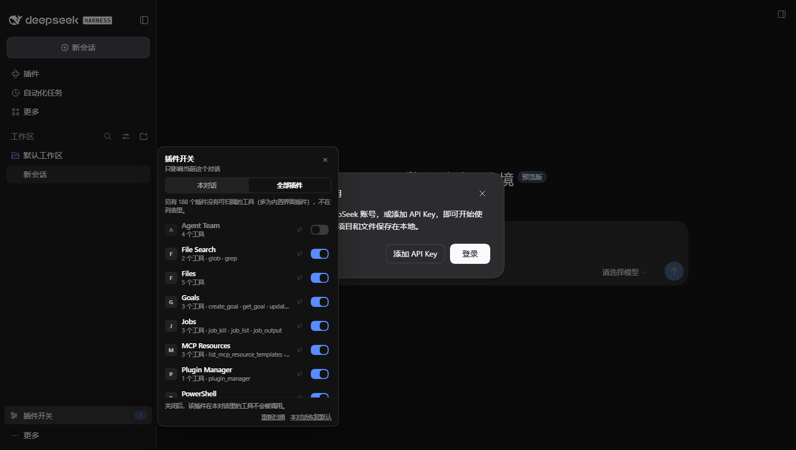

# dsh-session-switches

在每个对话里单独开关插件——同一个插件，在 A 对话里关掉，在 B 对话里照常可用。
开关住在侧边栏底部：点开「插件开关」，把常用的插件钉到「本对话」页签，然后逐个开关。



## 它解决什么问题

DSH 的插件是按 profile 全局加载的。想让某个对话别用 Web、别用子代理、别用 CAD，
以前只能改配置再重启，而重启会把所有对话一起改掉。这个插件把「装不装」和
「这个对话用不用」拆开：插件照常加载、界面照常存在，只是它注册的工具在这个对话里
调不到——模型会收到一句明确的拒绝说明，而不是静默失败。

## 界面

- 侧边栏底部一行「插件开关」，旁边的小数字是本对话已关掉的插件数。
- 面板优先贴在侧边栏右侧，窗口太窄时退回按钮上方；点外部区域或 Esc 关闭。
- 两个页签：**本对话**（只列你钉住的插件）和 **全部插件**（列出所有可归属工具的插件，
  行尾的图钉决定它是否出现在「本对话」）。
- 面板底部：「重新扫描」重读插件清单，「本对话恢复默认」把当前对话的关闭记录清空。

## 用法

1. 打开一个对话，点侧边栏底部的「插件开关」。
2. 切到「全部插件」，在图钉上点一下，把这个插件放进「本对话」页签。
3. 用右侧开关关掉它。关掉后，它的工具在本对话里不可调用；其他对话不受影响。
4. 换一个对话，同一份清单、各自独立的开关状态。

## 工作原理

- **状态**：`$DSH_HOME/session-plugin-switches.json`（默认 `~/.dsh/session-plugin-switches.json`），
  结构 `{ version, pinned: string[], sessions: { <sessionId>: { muted: string[], at } }, updatedAt }`。
  这是本机偏好而不是对话内容，所以不写进会话存储；最多保留 400 个对话的开关记录。
- **归属**：DSH 没有「插件 → 工具」的正式清单，插件在源码里调 `defineTool()` /
  `tools.register()` 注册工具。因此主机侧会扫描插件包的相关文件（src/lib/dist/build/es，
  单文件上限 1.6 MB），只取注册调用之后 600 字符内出现的 `name: 'tool_name'` 字面量，
  再与运行时真实挂载的工具名取交集。对于用 helper 拼名字的插件（`routeTool('map_driving_route', …)`），
  会在注册文件里再扫一遍工具形状的字面量，同样只保留能对上实时工具名的那些。
  交集为空时按字面量兜底，并在 UI 里标成「推定」。
- **拦截（双层）**：
  - 第一层 `tools.restrict({ deny })` 在 agent 创建和每次开关时重挂，让被关掉的工具
    直接从工具表里消失（对全局工具和预设作用域内的工具都生效）。
  - 第二层 `tools.guard()` 单调拒绝：即使某工具在 restrict 之后才挂载、或者名字没被
    restrict 认出来，调用时也会被挡下并回一句
    「插件「X」在本对话已关闭。可在侧边栏底部的「插件开关」中重新开启。」
- **RPC**：`POST /dsh-session-switches/rpc`，JSON，仅同源已认证连接可用；
  op 有 `state` / `toggle` / `pin` / `reset` / `rescan` / `probe`（probe 是排障用，UI 不暴露）。

## 安装

插件是标准的 DSH bundle 插件。在 profile（例如 `~/.dsh/profiles/desktop`）里：

```jsonc
// package.json
{
  "dependencies": {
    "dsh-session-switches": "file:C:/Users/zy270/.dsh/plugin-src/dsh-session-switches"
  },
  "dsh": { "profile": { "bundles": [ /* … 末尾加上 */ "dsh-session-switches" ] } }
}
```

再把包目录复制到 `<profile>/node_modules/dsh-session-switches`，然后重启 DSH 桌面端
（客户端 bundle 在启动时装载，热更新不可用）。

## 已知限制

- **归属靠源码扫描**，不是官方契约。压缩过或动态拼名字的插件可能扫不到工具；
  这类插件会显示「1 个工具」之外的空清单并被禁用开关，或者整条不列出
  （面板里会写「另有 N 个插件没有可归属的工具」）。内置界面插件大多属于后者，这是预期的。
- **同名工具是共享的**：如果两个插件注册了同名工具，关掉其中任意一个，这个名字在本对话里
  就整体被拒——拒绝按名字生效，无法区分注册者。
- 只影响**工具调用**，不影响插件的界面部件（侧边栏按钮、面板仍然在）。
- 开关状态按 sessionId 记录；新对话默认全开，需要重新关一遍（或钉住后逐个点）。
- 插件被卸载/重装导致 entry id 变化时，旧记录会被自动清掉（快照里剪枝）。

## 开发

```bash
node scripts/build-client.mjs   # 把 src/client/index.js 包成 window.__ModuleLoader__ CJS
node test/selftest.mjs          # 49 项自测：catalog / guard / toggle / pin / RPC / bundle
```

没有打包器依赖：客户端代码不用 JSX，构建只做 `window.__ModuleLoader__.load({ id, factory })` 包装，
运行时只 `require('react')`。
